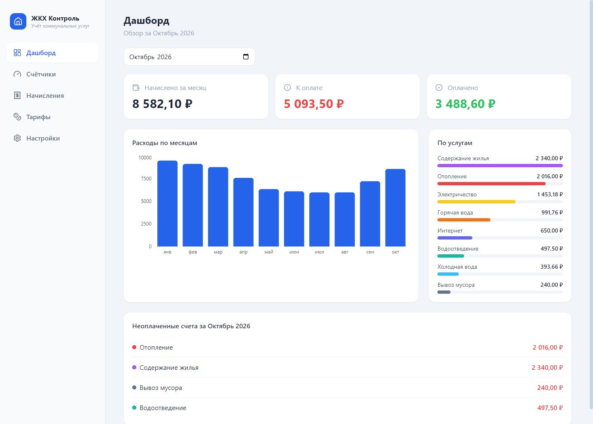
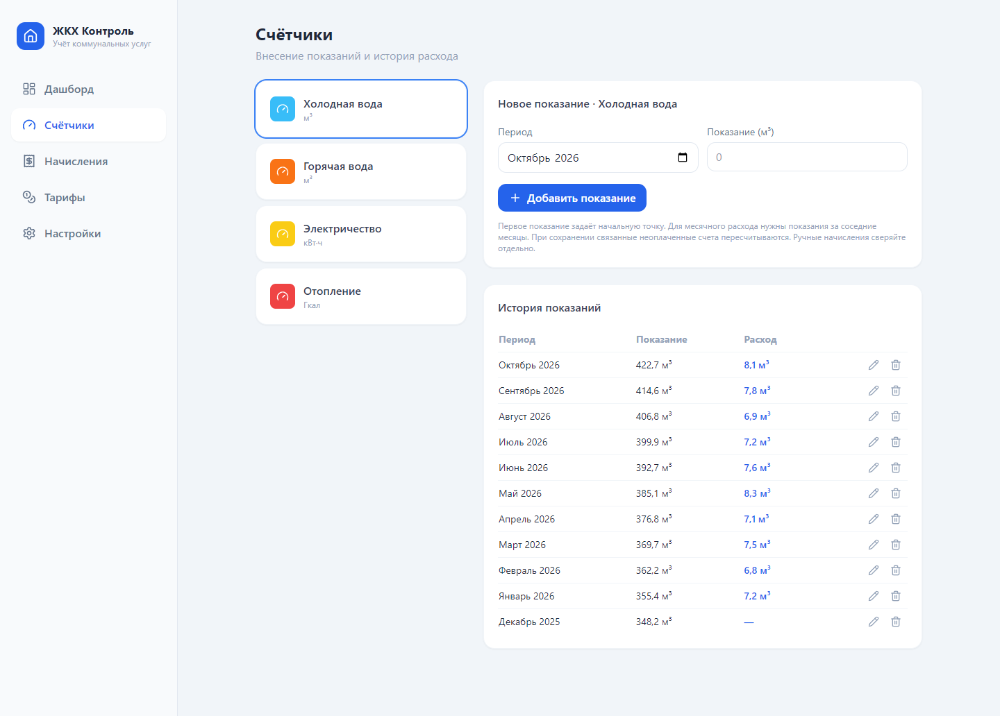
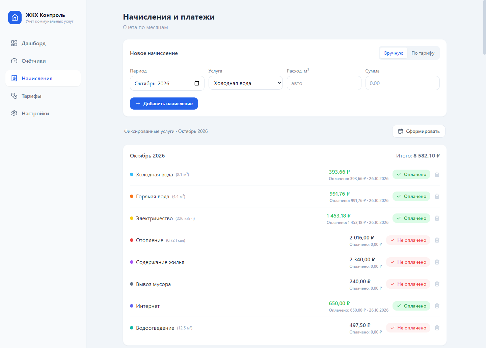
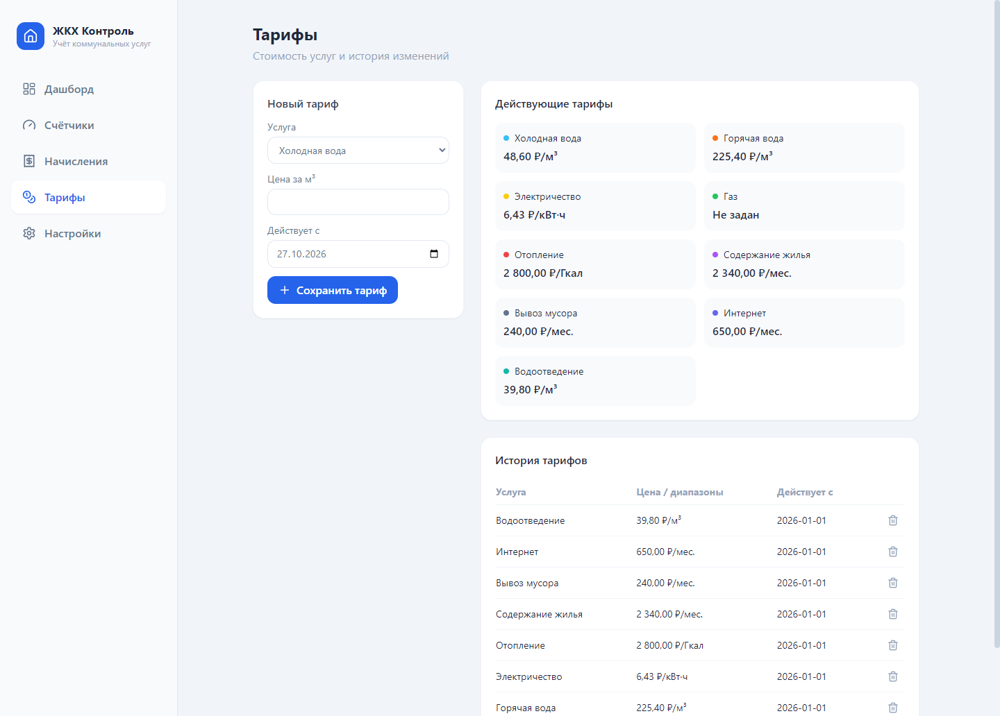

<div align="center">


# ЖКХ Контроль

**Коммунальные расходы под контролем.**

Показания счётчиков, тарифы, начисления и платежи — в одном приложении для Windows.


[Возможности](#возможности) · [Интерфейс](#интерфейс) · [Запуск](#запуск) · [Сборка](#сборка-для-windows)

</div>



## Возможности

| Раздел | Что можно делать |
| --- | --- |
| **Дашборд** | Смотреть начисления, оплаченные суммы и остаток к оплате; сравнивать расходы по месяцам и услугам. |
| **Счётчики** | Вносить показания воды, электричества и других счётчиков; отслеживать историю и месячный расход. |
| **Тарифы** | Задавать стоимость услуг с датой начала действия; сохранять историю изменений и использовать диапазоны для электричества. |
| **Начисления** | Рассчитывать суммы по показаниям и тарифам, добавлять счета вручную, формировать фиксированные платежи и отмечать оплату. |
| **Настройки** | Выбирать учитываемые услуги и счётчики, указывать данные квартиры, сохранять и восстанавливать резервные копии. |

При изменении показаний связанные неоплаченные счета пересчитываются. Изменения, затрагивающие оплаченный счёт, блокируются до снятия отметки оплаты.

## Интерфейс

На скриншотах — вымышленные демонстрационные данные с реалистичной историей потребления и платежей. Тарифы приведены для примера.

### Показания и расход

История по каждому счётчику: период, накопленное показание и расход за месяц.



### Начисления и платежи

Счета сгруппированы по месяцам. Для каждой услуги видны сумма, расход и статус оплаты.



### Тарифы и их история

Стоимость услуг и даты начала действия собраны на одном экране.



## Запуск

Для разработки нужны Node.js 22 LTS и npm.

```bash
git clone https://github.com/Cinnapik/jkh-control.git
cd jkh-control
npm ci
npm run dev
```

Команда запускает Vite и открывает окно Electron. Новая установка начинает работу без показаний и начислений: добавьте свои тарифы и начальные показания в соответствующих разделах.

## Сборка для Windows

Выполните в Windows:

```bash
npm run dist
```

В папке `release/` появятся установщик и переносимая версия для Windows x64:

- `ЖКХ Контроль Setup 1.2.0.exe` — установка с выбором папки и созданием ярлыков.
- `JKH-Control-1.2.0-portable.exe` — запуск без установки.

Другие команды:

| Команда | Назначение |
| --- | --- |
| `npm run build` | Собрать интерфейс в `dist/`. |
| `npm run dist:dir` | Собрать распакованное приложение в `release/win-unpacked/`. |
| `npm test` | Проверить расчёты, миграции, платежи и восстановление данных. |

## Хранение данных

Приложение хранит историю локально в файле `jkh.sqlite` в пользовательской папке Electron. Для резервной копии откройте **Настройки → Сохранить резервную копию**. Восстановление из копии заменяет текущую базу.

Пользовательские базы, резервные копии, локальные настройки и готовые сборки исключены из репозитория. Демонстрационная база со скриншотов в приложение не включена.

## Технологии

**Electron 33 · React 18 · Vite 6 · Tailwind CSS 3 · SQLite / sql.js · Recharts · Lucide**
